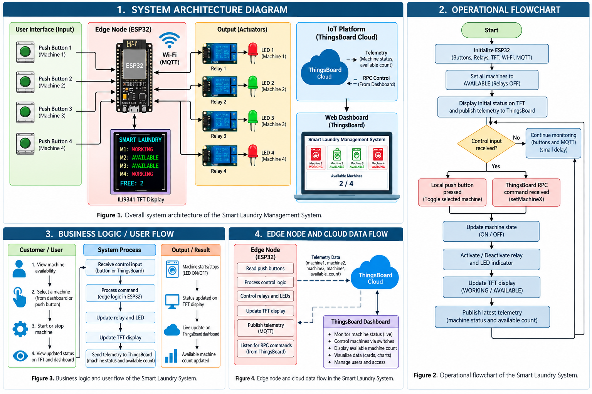
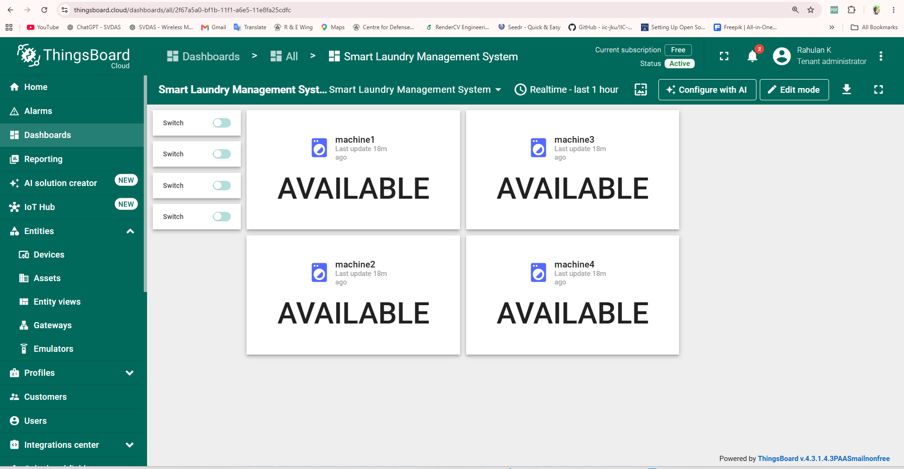
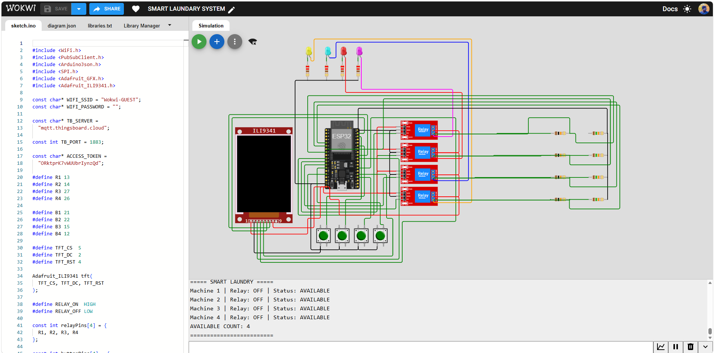
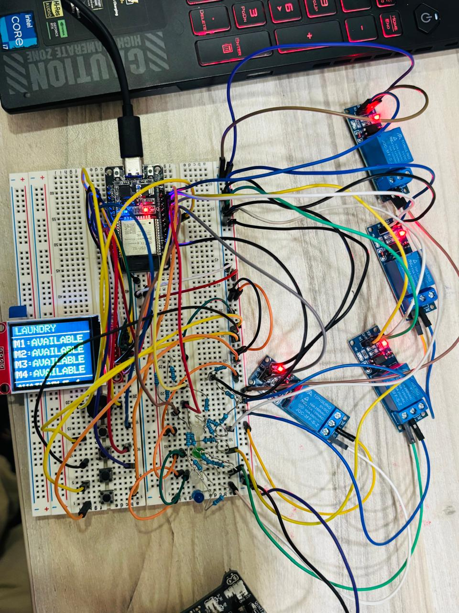

# Smart Laundry Management System

An **ESP32-based Industrial IoT smart laundry prototype** that monitors and controls four washing-machine channels using local push buttons and a ThingsBoard cloud dashboard.

The system provides local machine-status visualization, relay-based machine control, LED indicators, MQTT telemetry, and ThingsBoard RPC control.

<p align="center">
  
</p>

## Project Features

- Four independently controlled washing-machine channels
- ESP32 edge controller
- Four push-button local controls
- Four relay outputs
- Four LED machine-status indicators
- TFT status display
- AVAILABLE / WORKING machine states
- Available-machine counter
- Wi-Fi connectivity
- MQTT telemetry to ThingsBoard
- Four ThingsBoard RPC control switches
- Wokwi proof-of-concept simulation
- Physical hardware prototype

## System Overview

The ESP32 acts as the edge controller. Local push buttons allow direct operation of each machine channel. Each channel drives a relay and LED indicator. The TFT shows the status of all four channels and the number of available machines. When connected to the internet, the ESP32 publishes telemetry to ThingsBoard and listens for RPC commands from the dashboard.

> **Prototype note:** The final demonstrated version reports the commanded relay/channel state. It does not independently verify that a real washing-machine motor is operating.

## Hardware Used

| Component | Quantity | Purpose |
|---|---:|---|
| ESP32 DevKit | 1 | Main edge controller |
| Relay modules | 4 | Machine channel switching |
| Push buttons | 4 | Local machine control |
| LEDs | 4 | Machine-status indicators |
| TFT display | 1 | Local status and availability display |
| Resistors / breadboard / jumper wires | As required | Prototype interconnection |

## GPIO Summary

| Function | GPIO |
|---|---:|
| Relay 1 | 13 |
| Relay 2 | 14 |
| Relay 3 | 27 |
| Relay 4 | 26 |
| Button 1 | 21 |
| Button 2 | 22 |
| Button 3 | 15 |
| Button 4 | 12 |
| Buzzer | 25 |
| TFT CS | 5 |
| TFT RST | 4 |
| TFT DC | 2 |
| TFT MOSI | 23 |
| TFT SCK | 18 |

More details: [`docs/PINOUT.md`](docs/PINOUT.md)

## ThingsBoard

The firmware uses ThingsBoard Cloud MQTT communication.

**Telemetry**

- `machine1` … `machine4`
- `machine1_available` … `machine4_available`
- `available_count`

**RPC methods**

- `setMachine1`
- `setMachine2`
- `setMachine3`
- `setMachine4`

Dashboard details: [`docs/THINGSBOARD.md`](docs/THINGSBOARD.md)

<p align="center">
  
</p>

## Simulation

The system was validated in Wokwi before physical hardware implementation.

<p align="center">
  
</p>

Example states:

| State | Result |
|---|---|
| Startup | All four channels AVAILABLE |
| Button press | Selected channel toggles WORKING / AVAILABLE |
| Relay active | Corresponding LED indicates channel state |
| TFT | Displays all four statuses and free count |
| ThingsBoard RPC | Remote switch controls selected channel |
| Telemetry | Dashboard receives machine statuses and count |

## Physical Prototype

<p align="center">
  
</p>

The physical prototype uses an ESP32, four relay modules, four push buttons, four LEDs and a TFT display on a breadboard-based test setup.

## Repository Structure

```text
Smart-Laundry-IoT-GitHub/
├── README.md
├── SECURITY.md
├── .gitignore
├── firmware/
│   └── hardware/
│       ├── smart_laundry_hardware.ino
│       └── README.md
├── docs/
│   ├── PINOUT.md
│   ├── THINGSBOARD.md
│   ├── EVIDENCE.md
│   ├── diagrams/
│   └── screenshots/
├── hardware/
│   └── photos/
├── links/
│   └── PROJECT_LINKS.md
└── assets/
    └── original_uploads/
```

## Running the Hardware Firmware

1. Open `firmware/hardware/smart_laundry_hardware.ino` in Arduino IDE.
2. Install the required libraries used by the sketch.
3. Enter your local Wi-Fi credentials and ThingsBoard device token **only in your local copy**.
4. Select the correct ESP32 board and COM port.
5. Upload the firmware.
6. Open Serial Monitor at `115200` baud.
7. Verify local buttons, TFT states and ThingsBoard connectivity.

## Project Evidence and Videos

Demo videos and the original project Drive resources are listed in [`links/PROJECT_LINKS.md`](links/PROJECT_LINKS.md).

## Security

The GitHub-ready firmware has been sanitized. Real Wi-Fi passwords and ThingsBoard tokens are intentionally not included. See [`SECURITY.md`](SECURITY.md).

## Project Status

- [x] System architecture completed
- [x] Wokwi simulation completed
- [x] Local push-button control completed
- [x] Relay/LED control completed
- [x] TFT status display completed
- [x] ThingsBoard telemetry completed
- [x] ThingsBoard RPC control completed
- [x] Physical prototype demonstrated

## Scope / Limitation

This is an educational Industrial IoT prototype. The demonstrated version uses relay/channel command states to represent washing-machine availability. A production system should use electrically isolated sensing, suitable mains-rated switching/protection, machine feedback, enclosure design, authentication/access control, and appropriate electrical safety practices.
